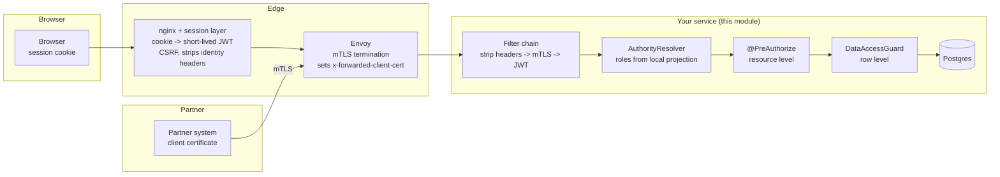

# security-spring-boot-starter

***English** · [Русский](README.ru.md)*

Authentication and authorization for Spring Boot services behind an nginx/Envoy edge. One principal
(`LudwigPrincipal`) for browser users (session cookie exchanged for a JWT at the edge), mTLS partners (Envoy
`x-forwarded-client-cert`) and peer services; roles resolved per service from a local projection instead of from
token claims; data-level authorization compiled into type-safe QueryDSL predicates plus a single-object check;
personal access token attenuation; localized RFC 9457 401/403; audit and metrics. Every default fails closed.

| | |
|---|---|
| Role | starter |
| Depends on (in-repo) | [`audit-core`](../audit-core), [`cache-spring-boot-starter`](../cache-spring-boot-starter), [`pat-core`](../pat-core), [`web-core-spring-boot-starter`](../web-core-spring-boot-starter) |
| Used by | `export`, `file-action`, `grpc-client`, `grpc-server`, `identity-projection`, `pat`, `user-settings` starters, `test-support-security`; both services |
| Surfaces | REST (filter chain, method security); outbound introspection call (optional PAT filter) |

Deployment model this module assumes:

- browser users hold an **opaque session cookie**; the edge exchanges it for a short-lived JWT per request;
- partners call the REST API over **mTLS**, terminated by Envoy;
- peer services call with their own **workload identity**;
- the OIDC provider issues **identity only** (no roles) and streams the user directory over Kafka into each
  service's database ([identity-projection](../identity-projection-spring-boot-starter));
- access is restricted **by resource** (may this caller call this endpoint) and **by data** (which rows).

### Edge vs service

| Concern | Where | Why |
|---|---|---|
| TLS/mTLS termination, client certificate validation | **Edge** | Holds the keys and the partner trust bundle |
| Session cookie → JWT, CSRF, session revocation | **Edge** | The session store lives there; a service that never sees a cookie cannot be CSRF'd |
| Stripping client-supplied identity headers | **Edge and service** | One misconfigured route would otherwise be privilege escalation |
| Coarse routing denials, rate limits, size caps | **Edge** | Cheap; keeps abuse off the service |
| Token validation (signature, issuer, **audience**, expiry) | **Service** | Audience is per service; a service must not assume it is only reached through the gateway |
| Role / permission checks | **Service** | Roles are the service's own vocabulary |
| Data scope (which rows) | **Service** | The gateway does not know what a row is |

A gateway cannot do row-level authorization, and gateway-only enforcement fails open for every path that does not
traverse it (service-to-service calls, Kafka consumers, schedulers, port-forwards). The gateway is defence in depth,
never the decision point.



### The three callers

| | Browser user | Partner | Peer service |
|---|---|---|---|
| Credential at the edge | session cookie | client certificate | workload certificate |
| Credential at the service | JWT minted by the edge | `x-forwarded-client-cert` | JWT (client credentials) or XFCC |
| Identity | OIDC `sub` | partner code | SPIFFE workload id |
| `PrincipalType` | `USER` | `PARTNER` | `SERVICE` |
| Roles from | local projection of the OIDC stream | partner registry (table or config) | configuration |
| Typical data scope | `OWN`, `TENANT` or `ALL` | `PARTNER` | `ALL` for its narrow purpose |

### Why roles are not in the token

The JWT carries `sub`, a name and maybe a tenant. Roles come from `AuthorityResolver`, implemented by
identity-projection against the Kafka-fed user table:

- **revocation is bounded by the authority cache TTL (seconds), not the token lifetime**;
- tokens stay small; granting a role needs no re-issue;
- each service owns its vocabulary;
- a token carrying a `roles` claim is harmless - nothing reads it.

The cost is a lookup per request; `AuthorityLookup` caches it in the platform cache `authorities`
(`purpose: security`, see [cache](../cache-spring-boot-starter)), and identity-projection evicts on every user change.

## Usage

```xml
<dependency>
    <groupId>ru.ludwigandreas</groupId>
    <artifactId>security-spring-boot-starter</artifactId>
</dependency>
<!-- roles and grants from the OIDC stream; without it nobody has any role -->
<dependency>
    <groupId>ru.ludwigandreas</groupId>
    <artifactId>identity-projection-spring-boot-starter</artifactId>
</dependency>
```

### Resource level

```java
@GetMapping("/{id}")
@PreAuthorize("hasAnyRole('ORDER_AGENT', 'ORDER_ADMIN')")
public OrderResponse get(@PathVariable UUID id) { ... }
```

Method security is enabled by the module.

### Data level

Declare which columns carry which scope dimension:

```java
@Bean
DataScopeMapping<OrderEntity> orderScopeMapping() {
    QOrderEntity order = QOrderEntity.orderEntity;
    return DataScopeMapping.forResource("order", OrderEntity.class)
            .owner(order.createdBy, OrderEntity::getCreatedBy)
            .tenant(order.tenantId, OrderEntity::getTenantId, UUID::fromString)
            .partner(order.partnerId, OrderEntity::getPartnerId)
            .build();
}
```

Write the policy in configuration:

```yaml
ludwig:
  security:
    data:
      default-access: NONE            # anything not listed is denied
      policies:
        order:
          read:
            ROLE_ORDER_ADMIN: ALL
            ROLE_ORDER_AGENT: OWN     # only rows they created
            ROLE_TENANT_VIEWER: TENANT
            ROLE_PARTNER: PARTNER
          write:
            ROLE_ORDER_ADMIN: ALL
            ROLE_ORDER_AGENT: OWN
```

Use it where rows are reached:

```java
// 1. Query time - the scope is part of the WHERE clause.
queryFactory.selectFrom(order)
        .where(guard.predicate("order", DataAction.READ).and(criteria))
        .fetch();

// 2. Load time - the safety net for paths a query predicate never sees.
OrderEntity entity = repository.getByIdOrThrow(id);
guard.check("order", DataAction.READ, entity, OrderEntity::getId);
```

or as an annotation backed by the same mapping: `@PostAuthorize("hasPermission(returnObject, 'read')")`.

**Both halves are needed.** Pre-filtering alone misses loads by id, relations and objects rebuilt from events;
post-checking alone breaks pagination and totals. The mapping declares a column (predicate) and an accessor (check)
together, so they cannot drift.

**Three shapes of rule:**

| Rule | Binding | Example |
|---|---|---|
| One column holds one value | `.owner` / `.tenant` / `.partner` / `.bind` | orders this user created |
| The row relates to many values, any may match | `.bindCollection` | orders this user is mentioned on |
| Anything else | `.bindExpression` | mentioned or creator, and not revoked |

```java
DataScopeMapping.forResource("order", OrderEntity.class)
        .owner(order.createdBy, OrderEntity::getCreatedBy)
        .bindCollection(ScopeDimension.of("mentioned"),
                order.mentions.any().userId,                                   // query side: correlated EXISTS
                e -> e.getMentions().stream().map(Mention::getUserId).toList()) // load side
        .build();
```

`.bindExpression` is the escape hatch where nothing verifies that predicate and check agree; test them against each
other (`ExpressionScopeBindingTest` shows how).

**Custom values** come from a `DataScopeProvider`:

```java
@Bean
DataScopeProvider loaderMentionScopeProvider() {
    return (principal, resourceType, action) ->
            "order".equals(resourceType)
                    && DataAction.READ.equals(action)
                    && principal.hasRole("ROLE_LOADER")
                    ? DataScope.restrictedTo(ScopeDimension.of("mentioned"), principal.subject())
                    : DataScope.none();   // contributes nothing; other providers still apply
}
```

**Composition**: values within a dimension are OR-ed (`IN`); dimensions within a grant are AND-ed (`OWN+TENANT`);
grants are OR-ed; `ALL` beats everything; `NONE` contributes nothing. Providers are unioned
(`CompositeDataScopeProvider`), so a provider can only **widen**; denial is no provider granting. A list endpoint
for a caller entitled to nothing returns an **empty page**, not 403. The full model and worked examples are in
[`docs/data-scope-configuration.md`](../../docs/data-scope-configuration.md).

### Background work

`SystemPrincipalTemplate` runs scheduler and listener code under an explicit system identity
(`ludwig.security.system-principal.*`).

### Personal access tokens

A PAT is an **attenuation** of its owner's live authority. This module reads the `ludwig_pat` claim from the
assertion the edge exchanged and narrows the authorities it resolved:

```
effective = authoritiesOf(owner, now)  ∩  token.scopes()
```

- A role revoked from the owner stops working for their tokens within the authority cache TTL, with no token
  revocation. A token can stop working without being revoked; the denial record names the token and the missing
  authority.
- A token scoped to authority its owner never held grants nothing.
- `PrincipalType` stays three values: a token caller is the same person with less authority. The presented
  credential is on `LudwigAuthentication`, not the principal: `authentication.credential().isLongLived()`,
  `.credentialId()`, `SecurityPrincipals.currentCredential()`.
- A `ludwig_pat` claim whose scope list cannot be read is **rejected** (falling through to "no attenuation" would grant
  full authority). A claim of the wrong *type* is ignored (it cannot come from the exchange).
- Audience scoping needs no new code: `AudienceValidator` enforces the `aud` the exchange mints
  (`PatAudienceScopingTest`).

**Direct PAT authentication** (for an edge that cannot exchange):

```yaml
ludwig:
  security:
    pat:
      filter:
        enabled: true                               # off by default
        issuer-base-url: https://idp.internal
        introspection-path: /introspect
        timeout: 2s
```

The filter recognises `lpat_`, introspects at the issuer (RFC 7662) and builds the authentication through the same
construction site, so the attenuation is identical. One token table and one revocation point remain. The resource
server's bearer-token resolver reports no token for `lpat_` values, so the JWT filter does not reject them first.
Trade-off: issuer availability is needed on each introspection cache miss (fails closed). Remove by setting
`enabled: false` when the edge gains exchange support (`PatDirectAuthenticationIT` covers both configurations).

**Revocation window** - computed, logged and validated at startup (fails above `max-revocation-window`):

```
request/response:   assertion lifetime + edge cache lifetime + authority cache TTL
long-lived:         revalidation interval + authority cache TTL
direct filter:      introspection cache TTL + authority cache TTL   (computed even when disabled)
```

## Configuration

```yaml
spring:
  security:
    oauth2:
      resourceserver:
        jwt:
          # issuer-uri performs OIDC discovery at startup: the service will not start while the provider is
          # unreachable. Use jwk-set-uri (fetched lazily) if that matters.
          issuer-uri: https://login.example.internal/realms/corp

ludwig:
  security:
    enabled: true
    problem-type-prefix: "urn:ludwig:security:"
    public-paths: [/actuator/health, /actuator/health/**, /actuator/info]   # replaces the default list
    strip-identity-headers: true
    jwt:
      enabled: true
      subject-claim: sub
      name-claim: name
      tenant-claim: tenant_id
      service-client-claim: client_id   # presence marks the token as a peer service's
      audiences: [my-service]
      require-audience: true
    mtls:
      enabled: false
      trusted-proxies: []               # required when enabled; 0.0.0.0/0 is refused
      trust-native-forward-headers: false
      service-identity-prefix: spiffe://mesh/ns/
      partners:                         # or identity-projection's security_partner table
        acme:
          display-name: ACME GmbH
          spiffe-id: spiffe://partners/acme
          certificate-hash: 468ed3...   # optional pin; update at every renewal
    authorities:
      require-resolver: false           # set true in every deployed environment
    data:
      enabled: true
      default-access: NONE
      strict-policy-tokens: true
      unscoped-resources: []            # reference data, deliberately exempt
      policies: {}
    pat:
      assertion-lifetime: 5m            # match the issuer
      edge-cache-lifetime: 5m           # match the edge
      revalidation-interval: 1m
      max-revocation-window: 15m
      validate-revocation-window: true
      filter: { enabled: false, issuer-base-url: , introspection-path: /introspect, timeout: 2s }
    audit:
      enabled: true
      log-grants: false
    metrics:
      enabled: true
    system-principal:
      subject: system
      roles: []
```

The authority cache is configured under `ludwig.cache.caches.authorities.*` (TTL = how long a revoked role still
works; `purpose: security` enforces a ceiling). The introspection cache is `ludwig.cache.caches.pat-introspection.*`.

## Deployment

### Edge (Envoy) for mTLS partners

```yaml
forward_client_cert_details: SANITIZE_SET   # replace any inbound XFCC; never append to a client's
set_current_client_cert_details:
  uri: true        # SPIFFE id - survives renewal
  dns: true
  subject: true
  cert: false      # the PEM would put kilobytes into every log line
```

`APPEND_FORWARD` would let a client prepend its own element. Reference configurations:
[`docs/envoy-partner-gateway.yaml`](docs/envoy-partner-gateway.yaml), [`docs/nginx-edge.conf`](docs/nginx-edge.conf).

**`trusted-proxies` is load-bearing**: `x-forwarded-client-cert` is an ordinary header, trustworthy only because only
the proxy can reach the port. Set it to the sidecar/ingress subnet and nothing wider; `0.0.0.0/0` is refused. The
header from any other peer is **rejected** (not ignored) and counted.

**`server.forward-headers-strategy`**: `framework` is safe (the module unwraps to the container's peer address);
`native` (Tomcat `RemoteIpValve`) trusts `X-Forwarded-For` from any private-range peer and lets any workload
impersonate the sidecar - **startup fails** with mTLS enabled. If `native` is needed, narrow
`server.tomcat.remoteip.internal-proxies` and set `ludwig.security.mtls.trust-native-forward-headers=true`.

Partners are matched by SPIFFE URI, then DNS SAN, then exact subject DN, optionally pinned to a fingerprint. Map to
an identifier that survives certificate renewal.

### CSRF and statelessness

The filter chain is stateless and CSRF is off: the session cookie never reaches the service. **If a service ever
accepts the session cookie directly, re-enable CSRF in the same change.**

### Adoption procedure for an existing service

1. Add the module with `data.default-access: ALL`. Watch `ludwig.security.data.scope`: every resource reporting
   `ALL` has no policy yet.
2. Write `DataScopeMapping` beans and policies, starting with the most sensitive data.
3. Switch `default-access` to `NONE` once no unexplained `ALL` remains (per service, not fleet-wide).
4. Turn on `authorities.require-resolver` and `jwt.require-audience` in every deployed environment.
5. Enable mTLS on partner routes last, after `trusted-proxies` is correct in each environment.

## Observability

**Metrics:**

| Metric | Type | Tags | Meaning |
|---|---|---|---|
| `ludwig.security.authentication` | counter | `principal.type`, `outcome`, `reason` | Authentication results; `reason=untrusted-proxy` = something bypasses the mesh |
| `ludwig.security.access.denied` | counter | `resource`, `action` | Denials (role and row level) |
| `ludwig.security.authorities.cache` | counter | `principal.type`, `result` | Authority cache hits/misses |
| `ludwig.security.data.scope` | counter | `resource`, `access` | Effective scope width; `access=ALL` on a restricted resource = a policy is not matching |

Tags use a bounded vocabulary only; nothing caller-controlled.

**Logs** (`WARN` unless noted): XFCC from an untrusted peer (rejected), certificate matched by identifier but
fingerprint differs, no partner registered for a certificate, PAT introspection unreachable, unusable data-scope
value, `hasPermission` without a mapping (denied), `public-paths` entry that permits a broad pattern,
`validate-revocation-window=false`, failed denial audit. `INFO`: audience validation enabled, PAT revocation window
values, resource with a mapping but no policy.

**Recommended alerts:**

| Condition | Why |
|---|---|
| `increase(ludwig_security_authentication_total{reason="untrusted-proxy"}[5m]) > 0` | Direct access bypassing the mesh, or spoofing |
| Spike in `ludwig_security_access_denied_total` for one resource | Probing, or a broken client/role mapping |
| `ludwig_security_data_scope_total{access="ALL"}` for a resource expected to be restricted | Policy not matching |
| Log `Could not introspect a personal access token` | Issuer down: PATs failing closed |

## Audit

Decisions go through the platform `AuditSink`:

| Field | Value |
|---|---|
| category | `access` |
| action | `access.denied` (role-level via `AuthorizationDeniedAuditListener`, row-level via `DataAccessGuard`); `access.granted` only with `audit.log-grants: true` |
| outcome | `DENIED` for refusals (not `FAILURE`) |
| attributes | resource type and id, action, reason, `scopeAccess`, PAT id and missing authority for token denials |

No payloads, no tokens. `PrincipalActorResolver` (registered regardless of `ludwig.security.enabled` and
`audit.enabled`) teaches the platform's actor resolution about `LudwigPrincipal`, so every `AuditEvent.actor` and
`created_by` carry the subject.

**Known gap:** authentication failures (missing, invalid or expired tokens, rejected certificates) are counted in
`ludwig.security.authentication` but not recorded in the audit trail.

## Runbook

| Symptom | Likely cause | What to do |
|---|---|---|
| Service does not start: OIDC discovery | `issuer-uri` provider unreachable | Restore connectivity, or use `jwk-set-uri` |
| Startup fails on a policy | Unmapped resource, unknown dimension, misspelled grant, resource both unscoped and policed | Fix as the message names |
| Startup fails: `trusted-proxies` / `forward-headers-strategy=native` | Unsafe mTLS settings | Narrow proxies; see Deployment |
| Startup fails: no audience / no resolver | `require-audience` / `require-resolver` with nothing configured | Configure `jwt.audiences`; add identity-projection |
| All users get 403 | No `AuthorityResolver` data (projection empty), or policy `default-access: NONE` without entries | Check identity-projection consumption; check policies |
| A user still has a revoked role | Authority cache TTL | Wait ≤ TTL (`ludwig.cache.caches.authorities.ttl`) |
| Partner gets 401 after certificate renewal | Partner mapped by a non-stable identifier or pinned fingerprint | Map by SPIFFE URI/SAN; update `certificate-hash` |
| `reason=untrusted-proxy` | Request reached the pod without the mesh proxy | Find the path (port-forward, extra ingress); fix network policy |
| 500 instead of 403 inside controllers | Neither web-core nor own advice handles `AccessDeniedException` | Add web-core (recommended) |
| "Why can't user X do Y?" | - | `SELECT occurred_at, action, resource_type, resource_id, reason, attributes FROM audit_event WHERE category = 'access' AND actor_subject = '<x>' ORDER BY occurred_at DESC LIMIT 50;` |
| PATs fail in a service using the direct filter | Issuer unreachable, `issuer-base-url` wrong | Check the `Could not introspect` warning and connectivity |

## Testing

Unit tests for XFCC parsing, trusted proxies, the mTLS filter, audience validation, authority caching, scope
composition and predicate building (including collection and expression bindings), the data guard and permission
evaluator, method-security auditing, problem mapping, PAT attenuation, the PAT-aware bearer resolver, introspection
client and cache, revocation window validation, auto-configuration. In a service, use
[`test-support-security`](../test-support-security) to build principals for MockMvc.

## Design decisions

| Situation | Behaviour | Why not the other way |
|---|---|---|
| Resource has no policy | Denied (`default-access: NONE`) | A new endpoint would ship unprotected |
| Policy names a resource with no mapping | Startup failure | It would be treated as unrestricted |
| Policy names an unbound dimension | Startup failure | An unenforceable clause must not be ignored |
| Misspelled grant (`OWNN`) | Startup failure | Otherwise a 500 on the first request using that role |
| Resource both unscoped and policed | Startup failure | One silently wins |
| Principal lacks a required dimension value | Denied | Dropping the clause turns "my tenant" into "all tenants" |
| Grant value unparseable for the column type | Denied | An empty set, not an absent filter |
| Role store unreachable | Request fails (500) | "No roles" on a blip is an outage and, on denial-phrased rules, a silent grant |
| XFCC from an untrusted peer | Rejected and counted | Ignoring hides spoofing |

- **No session handling, login pages or token issuance** - the edge's job.
- **No Hibernate `@Filter` or PostgreSQL RLS**: QueryDSL predicates over generated Q-types break the build on a column
  rename. Add RLS *underneath* for containment against a compromised service.
- **No distributed authority cache by default**: authorities are cheap to recompute and a shared cache is a
  poisoning target; eviction rides the Kafka topic every instance consumes.
- **Uninformative 401/403 bodies**; specifics are in the audit trail. Messages are overridable by defining the same
  key in the service's bundle.
- **No streaming-transport enforcement yet**: `revalidation-interval` exists; the first long-lived transport must add
  the enforcing test.
