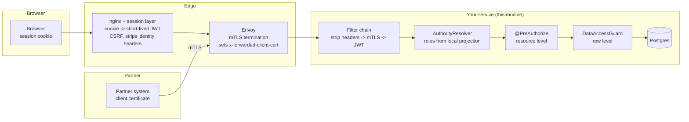

# security-spring-boot-starter

*[English](README.md) · **Русский***

Аутентификация и авторизация для сервисов Spring Boot за границей nginx/Envoy. Один принципал
(`LudwigPrincipal`) для пользователей браузера (сессионная cookie, обмениваемая на JWT на границе), партнёров по
mTLS (Envoy `x-forwarded-client-cert`) и соседних сервисов; роли определяются в каждом сервисе по локальной
проекции, а не из claim-ов токена; авторизация на уровне данных компилируется в типобезопасные предикаты QueryDSL
плюс проверку отдельного объекта; ослабление прав персональными токенами доступа; локализованные 401/403 RFC 9457;
аудит и метрики. Каждое значение по умолчанию закрыто.

| | |
|---|---|
| Роль | starter |
| Зависит от (в репозитории) | [`audit-core`](../audit-core), [`cache-spring-boot-starter`](../cache-spring-boot-starter), [`pat-core`](../pat-core), [`web-core-spring-boot-starter`](../web-core-spring-boot-starter) |
| Используется | стартерами `export`, `file-action`, `grpc-client`, `grpc-server`, `identity-projection`, `pat`, `user-settings`, модулем `test-support-security`; обоими сервисами |
| Поверхности | REST (цепочка фильтров, method security); исходящий вызов интроспекции (опциональный PAT-фильтр) |

Модель развёртывания, которую предполагает модуль:

- у пользователей браузера **непрозрачная сессионная cookie**; граница обменивает её на короткоживущий JWT на
  каждый запрос;
- партнёры вызывают REST API по **mTLS**, терминируемому Envoy;
- соседние сервисы приходят со своей **workload identity**;
- OIDC-провайдер выдаёт **только идентичность** (без ролей) и передаёт каталог пользователей по Kafka в БД каждого
  сервиса ([identity-projection](../identity-projection-spring-boot-starter));
- доступ ограничивается **по ресурсу** (может ли вызывающий вызвать эндпоинт) и **по данным** (какие строки).

### Граница или сервис

| Задача | Где | Почему |
|---|---|---|
| Терминирование TLS/mTLS, проверка клиентского сертификата | **Граница** | Там ключи и набор доверенных сертификатов партнёров |
| Cookie сессии → JWT, CSRF, отзыв сессии | **Граница** | Там хранилище сессий; сервис, не видящий cookie, не подвержен CSRF |
| Вырезание присланных клиентом заголовков идентичности | **Граница и сервис** | Один неверный маршрут иначе станет повышением привилегий |
| Грубые запреты маршрутов, rate limit, ограничения размера | **Граница** | Дёшево; отсекает злоупотребления до сервиса |
| Проверка токена (подпись, issuer, **audience**, срок) | **Сервис** | Audience - своя у каждого сервиса; сервис не должен считать, что до него доходят только через шлюз |
| Проверки ролей и прав | **Сервис** | Роли - словарь самого сервиса |
| Область данных (какие строки) | **Сервис** | Шлюз не знает, что такое строка |

Шлюз не умеет авторизацию на уровне строк, а принуждение только на шлюзе открыто для каждого пути, который его
обходит (вызовы между сервисами, Kafka-потребители, планировщики, port-forward). Шлюз - эшелон защиты, но никогда не
точка принятия решения.



### Три типа вызывающих

| | Пользователь браузера | Партнёр | Соседний сервис |
|---|---|---|---|
| Учётные данные на границе | сессионная cookie | клиентский сертификат | workload-сертификат |
| Учётные данные в сервисе | JWT, выпущенный границей | `x-forwarded-client-cert` | JWT (client credentials) или XFCC |
| Идентичность | OIDC `sub` | код партнёра | SPIFFE workload id |
| `PrincipalType` | `USER` | `PARTNER` | `SERVICE` |
| Роли из | локальной проекции потока OIDC | реестра партнёров (таблица или конфигурация) | конфигурации |
| Типичная область данных | `OWN`, `TENANT` или `ALL` | `PARTNER` | `ALL` для своей узкой задачи |

### Почему ролей нет в токене

JWT несёт `sub`, имя и, возможно, тенант. Роли даёт `AuthorityResolver`, реализованный identity-projection над
таблицей пользователей, наполняемой из Kafka:

- **отзыв ограничен TTL кэша прав (секунды), а не сроком жизни токена**;
- токены маленькие; выдача роли не требует перевыпуска;
- каждый сервис владеет своим словарём;
- токен с claim `roles` безвреден - его никто не читает.

Цена - обращение на каждый запрос; `AuthorityLookup` кэширует его в платформенном кэше `authorities`
(`purpose: security`, см. [cache](../cache-spring-boot-starter)), а identity-projection вытесняет записи при каждом
изменении пользователя.

## Использование

```xml
<dependency>
    <groupId>ru.ludwigandreas</groupId>
    <artifactId>security-spring-boot-starter</artifactId>
</dependency>
<!-- роли и выдачи из потока OIDC; без него ни у кого нет ролей -->
<dependency>
    <groupId>ru.ludwigandreas</groupId>
    <artifactId>identity-projection-spring-boot-starter</artifactId>
</dependency>
```

### Уровень ресурса

```java
@GetMapping("/{id}")
@PreAuthorize("hasAnyRole('ORDER_AGENT', 'ORDER_ADMIN')")
public OrderResponse get(@PathVariable UUID id) { ... }
```

Method security включается модулем.

### Уровень данных

Объявите, какие колонки несут какое измерение области:

```java
@Bean
DataScopeMapping<OrderEntity> orderScopeMapping() {
    QOrderEntity order = QOrderEntity.orderEntity;
    return DataScopeMapping.forResource("order", OrderEntity.class)
            .owner(order.createdBy, OrderEntity::getCreatedBy)
            .tenant(order.tenantId, OrderEntity::getTenantId, UUID::fromString)
            .partner(order.partnerId, OrderEntity::getPartnerId)
            .build();
}
```

Опишите политику в конфигурации:

```yaml
ludwig:
  security:
    data:
      default-access: NONE            # всё, что не указано, запрещено
      policies:
        order:
          read:
            ROLE_ORDER_ADMIN: ALL
            ROLE_ORDER_AGENT: OWN     # только созданные им строки
            ROLE_TENANT_VIEWER: TENANT
            ROLE_PARTNER: PARTNER
          write:
            ROLE_ORDER_ADMIN: ALL
            ROLE_ORDER_AGENT: OWN
```

Используйте там, где достигаются строки:

```java
// 1. Во время запроса - область входит в WHERE.
queryFactory.selectFrom(order)
        .where(guard.predicate("order", DataAction.READ).and(criteria))
        .fetch();

// 2. Во время загрузки - страховка для путей, которых не видит предикат запроса.
OrderEntity entity = repository.getByIdOrThrow(id);
guard.check("order", DataAction.READ, entity, OrderEntity::getId);
```

или аннотацией на том же отображении: `@PostAuthorize("hasPermission(returnObject, 'read')")`.

**Нужны обе половины.** Только предфильтр пропускает загрузки по id, связи и объекты, восстановленные из событий;
только постпроверка ломает пагинацию и итоги. Отображение объявляет колонку (предикат) и accessor (проверку)
вместе, поэтому они не расходятся.

**Три формы правила:**

| Правило | Привязка | Пример |
|---|---|---|
| Одна колонка - одно значение | `.owner` / `.tenant` / `.partner` / `.bind` | заказы, созданные пользователем |
| Строка связана со многими значениями, подходит любое | `.bindCollection` | заказы, где пользователь упомянут |
| Всё остальное | `.bindExpression` | упомянут или создатель, и не отозван |

```java
DataScopeMapping.forResource("order", OrderEntity.class)
        .owner(order.createdBy, OrderEntity::getCreatedBy)
        .bindCollection(ScopeDimension.of("mentioned"),
                order.mentions.any().userId,                                   // сторона запроса: коррелированный EXISTS
                e -> e.getMentions().stream().map(Mention::getUserId).toList()) // сторона загрузки
        .build();
```

`.bindExpression` - запасной выход, где ничто не проверяет согласие предиката и проверки; тестируйте их друг против
друга (пример - `ExpressionScopeBindingTest`).

**Собственные значения** даёт `DataScopeProvider`:

```java
@Bean
DataScopeProvider loaderMentionScopeProvider() {
    return (principal, resourceType, action) ->
            "order".equals(resourceType)
                    && DataAction.READ.equals(action)
                    && principal.hasRole("ROLE_LOADER")
                    ? DataScope.restrictedTo(ScopeDimension.of("mentioned"), principal.subject())
                    : DataScope.none();   // ничего не добавляет; другие провайдеры продолжают действовать
}
```

**Композиция**: значения внутри измерения объединяются по OR (`IN`); измерения внутри выдачи - по AND
(`OWN+TENANT`); выдачи - по OR; `ALL` сильнее всего; `NONE` ничего не добавляет. Провайдеры объединяются
(`CompositeDataScopeProvider`), поэтому провайдер может только **расширять**; запрет - это отсутствие выдачи.
Списочный эндпоинт для вызывающего без прав возвращает **пустую страницу**, а не 403. Полная модель и примеры -
в [`docs/data-scope-configuration.md`](../../docs/data-scope-configuration.md).

### Фоновая работа

`SystemPrincipalTemplate` выполняет код планировщиков и listener-ов под явной системной идентичностью
(`ludwig.security.system-principal.*`).

### Персональные токены доступа

PAT - **ослабление** текущих прав владельца. Модуль читает claim `ludwig_pat` из assertion, полученного обменом на
границе, и сужает определённые права:

```
effective = authoritiesOf(owner, now)  ∩  token.scopes()
```

- Роль, отозванная у владельца, перестаёт работать для его токенов в пределах TTL кэша прав без отзыва токена.
  Токен может перестать работать без отзыва; запись об отказе называет токен и пропавшее право.
- Токен с scope, которого у владельца никогда не было, ничего не даёт.
- `PrincipalType` по-прежнему три значения: вызывающий по токену - тот же человек с меньшими правами.
  Предъявленные учётные данные хранятся в `LudwigAuthentication`, а не в принципале:
  `authentication.credential().isLongLived()`, `.credentialId()`, `SecurityPrincipals.currentCredential()`.
- Claim `ludwig_pat` с нечитаемым списком scope **отклоняется** (проход без ослабления дал бы все права). Claim
  неверного *типа* игнорируется (он не может прийти из обмена).
- Ограничение по audience не требует нового кода: `AudienceValidator` проверяет `aud`, выпускаемый обменом
  (`PatAudienceScopingTest`).

**Прямая аутентификация PAT** (для границы, не умеющей обмен):

```yaml
ludwig:
  security:
    pat:
      filter:
        enabled: true                               # по умолчанию выключено
        issuer-base-url: https://idp.internal
        introspection-path: /introspect
        timeout: 2s
```

Фильтр распознаёт `lpat_`, выполняет интроспекцию у выпускающего сервиса (RFC 7662) и строит аутентификацию через
то же место построения, поэтому ослабление идентично. Таблица токенов и точка отзыва остаются одни. Резолвер
bearer-токена resource server-а сообщает об отсутствии токена для значений `lpat_`, чтобы JWT-фильтр не отклонил их
раньше. Компромисс: на каждом промахе кэша интроспекции нужна доступность выпускающего сервиса (отказ - закрыт).
Удаляется выставлением `enabled: false`, когда граница научится обмену (`PatDirectAuthenticationIT` проверяет обе
конфигурации).

**Окно отзыва** - вычисляется, логируется и проверяется при старте (падение при превышении
`max-revocation-window`):

```
запрос/ответ:       время жизни assertion + время кэша границы + TTL кэша прав
долгие соединения:  интервал перепроверки + TTL кэша прав
прямой фильтр:      TTL кэша интроспекции + TTL кэша прав   (вычисляется, даже если выключен)
```

### Административная поверхность

Все административные эндпоинты платформы обслуживаются под `/admin/v1/` и авторизуются одним способом. Модуль
**объявляет операции**, но никогда не роли; сервис-потребитель **выдаёт их своим ролям**.

| Элемент | Что это |
|---|---|
| Идентификатор операции | `<area>.<tier>`, например `outbox.operate`. Модуль, объявивший любой уровень области, объявляет все три |
| Уровни | `read` (ничего не меняет), `operate` (безопасно повторять, не рассинхронизирует и не меняет доступ), `privileged` (меняет доступ, может рассинхронизировать с внешней системой или отбрасывает работу) |
| `@AdminAccess(<Module>AdminOperations.OPERATE)` | На обработчике; единственный барьер. Никогда не сочетается с `@PreAuthorize` или проверкой роли |
| `@AdminAuthenticated` | Обработчик, доступный любому допущенному вызывающему (эндпоинт обнаружения) |
| `AdminAudit` | Записывает изменение через единственный `AuditSink`, категория `admin`, из сервиса модуля внутри его транзакции |
| `AdminInvocation.require()` | Текущая операция, вызывающий и причина; `tenantScope()` для таблиц с арендатором |
| `AdminPage` / `AdminCursor` | Keyset-страницы; не более 200 строк; нераскодируемый курсор - `400` |

```yaml
ludwig:
  admin:
    grants:
      outbox.read:       [NOTIFICATION_ADMIN, NOTIFICATION_SUPPORT]
      outbox.operate:    [NOTIFICATION_ADMIN]
      outbox.privileged: [NOTIFICATION_ADMIN]
```

В файле `.properties` ключ с точкой записывается в скобках: `ludwig.admin.grants[outbox.read]=NOTIFICATION_ADMIN`.
Роли - это разрешённые роли этого сервиса (проекция идентичности для людей, `ludwig.identity.service-roles` для
административных сервисов), а не claim токена; пересечение с PAT по-прежнему применяется.

Что отклоняет страж на `/admin/**` (`HandlerInterceptor`, поэтому он работает при любой цепочке фильтров сервиса),
по порядку:

| Вызывающий | Ответ |
|---|---|
| не аутентифицирован | `401` |
| партнёр | `403` |
| персональный токен доступа, если не задано `ludwig.admin.allow-personal-access-tokens=true` | `403`, `ludwig.pat.credential-not-permitted` - тот же тип, что у поверхности PAT |
| операция, которой у него нет | `403`, публикуется как отказ авторизации и аудируется |
| операция `privileged` без `Admin-Reason` (1-500 символов) | `400`, `ludwig.admin.reason-required` - только после проверки выдачи |
| обработчик под `/admin/` без обеих аннотаций | `403` |

Везде закрыто по умолчанию: **выдачи по умолчанию нет**, нет масок и нет вложенности уровней; операция, которой ни у
кого нет, отклоняется и один раз перечисляется при старте; опечатка в ключе выдачи, пустой список ролей, обработчик с
незаявленным идентификатором, область без одного из уровней и запись `public-paths`, совпадающая с `/admin/v1/`, -
каждое из этого роняет старт. Поверхность существует только при наличии конвейера ошибок web-core и не зависит от
method security (`ludwig.security.data.enabled=false` её не выключает). `ludwig.admin.enabled=false` её убирает.

Ограничение по арендатору: `USER` видит ресурсы только ровно своего арендатора (пользователь без арендатора - только
ресурсы без арендатора); `SERVICE` не ограничен. Модули применяют `tenantScope()` к таблицам с арендатором.

`GET /admin/v1/me/operations` перечисляет операции, которые есть у вызывающего, в формате `application/json`, с
описаниями на его языке, чтобы административный UI знал, какие элементы управления показывать. Запуск завершается
ошибкой, если ключ описания операции из каталога отсутствует во всех бандлах; в сообщении перечислены все такие
операции и ключи. Модуль, добавляющий область, добавляет ключи в свой бандл.

## Конфигурация

```yaml
spring:
  security:
    oauth2:
      resourceserver:
        jwt:
          # issuer-uri выполняет OIDC discovery при старте: сервис не стартует, пока провайдер недоступен.
          # Используйте jwk-set-uri (загружается лениво), если это важно.
          issuer-uri: https://login.example.internal/realms/corp

ludwig:
  security:
    enabled: true
    problem-type-prefix: "urn:ludwig:security:"
    public-paths: [/actuator/health, /actuator/health/**, /actuator/info]   # заменяет список по умолчанию
    strip-identity-headers: true
    jwt:
      enabled: true
      subject-claim: sub
      name-claim: name
      tenant-claim: tenant_id
      service-client-claim: client_id   # наличие помечает токен соседнего сервиса
      audiences: [my-service]
      require-audience: true
    mtls:
      enabled: false
      trusted-proxies: []               # обязательно при включении; 0.0.0.0/0 запрещено
      trust-native-forward-headers: false
      service-identity-prefix: spiffe://mesh/ns/
      partners:                         # или таблица security_partner в identity-projection
        acme:
          display-name: ACME GmbH
          spiffe-id: spiffe://partners/acme
          certificate-hash: 468ed3...   # опциональное закрепление; обновлять при каждом перевыпуске
    authorities:
      require-resolver: false           # true в каждом развёрнутом окружении
    data:
      enabled: true
      default-access: NONE
      strict-policy-tokens: true
      unscoped-resources: []            # справочные данные, намеренно без ограничений
      policies: {}
    pat:
      assertion-lifetime: 5m            # как у выпускающего
      edge-cache-lifetime: 5m           # как у границы
      revalidation-interval: 1m
      max-revocation-window: 15m
      validate-revocation-window: true
      filter: { enabled: false, issuer-base-url: , introspection-path: /introspect, timeout: 2s }
    audit:
      enabled: true
      log-grants: false
    metrics:
      enabled: true
    system-principal:
      subject: system
      roles: []
```

Кэш прав настраивается в `ludwig.cache.caches.authorities.*` (TTL = сколько ещё работает отозванная роль;
`purpose: security` обеспечивает потолок). Кэш интроспекции - `ludwig.cache.caches.pat-introspection.*`.

## Развёртывание

### Граница (Envoy) для партнёров по mTLS

```yaml
forward_client_cert_details: SANITIZE_SET   # заменить любой входящий XFCC; никогда не дописывать к клиентскому
set_current_client_cert_details:
  uri: true        # SPIFFE id - переживает перевыпуск
  dns: true
  subject: true
  cert: false      # PEM добавил бы килобайты в каждую строку лога
```

`APPEND_FORWARD` позволил бы клиенту подставить свой элемент. Эталонные конфигурации:
[`docs/envoy-partner-gateway.yaml`](docs/envoy-partner-gateway.yaml), [`docs/nginx-edge.conf`](docs/nginx-edge.conf).

**`trusted-proxies` несёт нагрузку**: `x-forwarded-client-cert` - обычный заголовок, которому можно верить только
потому, что до порта может дойти только прокси. Задайте подсеть sidecar/ingress и ничего шире; `0.0.0.0/0`
запрещено. Заголовок от любого другого узла **отклоняется** (а не игнорируется) и учитывается.

**`server.forward-headers-strategy`**: `framework` безопасен (модуль разворачивает адрес до того, что видел
контейнер); `native` (Tomcat `RemoteIpValve`) доверяет `X-Forwarded-For` от любого узла частной сети и позволяет
любой нагрузке выдать себя за sidecar - при включённом mTLS **старт падает**. Если `native` нужен, сузьте
`server.tomcat.remoteip.internal-proxies` и выставьте `ludwig.security.mtls.trust-native-forward-headers=true`.

Партнёры сопоставляются по SPIFFE URI, затем DNS SAN, затем точному subject DN, с опциональным закреплением
отпечатка. Сопоставляйте по идентификатору, переживающему перевыпуск сертификата.

### CSRF и отсутствие состояния

Цепочка фильтров без состояния, CSRF выключен: сессионная cookie не доходит до сервиса. **Если сервис когда-либо
станет принимать сессионную cookie напрямую, включите CSRF в том же изменении.**

### Порядок внедрения в существующий сервис

1. Добавьте модуль с `data.default-access: ALL`. Следите за `ludwig.security.data.scope`: каждый ресурс с `ALL`
   ещё без политики.
2. Напишите бины `DataScopeMapping` и политики, начиная с самых чувствительных данных.
3. Переключите `default-access` на `NONE`, когда необъяснённых `ALL` не останется (по сервису, не на весь парк).
4. Включите `authorities.require-resolver` и `jwt.require-audience` во всех развёрнутых окружениях.
5. Включите mTLS на партнёрских маршрутах последним, когда `trusted-proxies` верен в каждом окружении.

## Наблюдаемость

**Метрики:**

| Метрика | Тип | Теги | Смысл |
|---|---|---|---|
| `ludwig.security.authentication` | counter | `principal.type`, `outcome`, `reason` | Результаты аутентификации; `reason=untrusted-proxy` - кто-то обходит mesh |
| `ludwig.security.access.denied` | counter | `resource`, `action` | Отказы (на уровне ролей и строк) |
| `ludwig.security.authorities.cache` | counter | `principal.type`, `result` | Попадания/промахи кэша прав |
| `ludwig.security.data.scope` | counter | `resource`, `access` | Фактическая ширина области; `access=ALL` на ограниченном ресурсе - политика не срабатывает |

Теги - только из ограниченного словаря; ничего, чем управляет вызывающий.

**Логи** (`WARN`, если не указано иное): XFCC от недоверенного узла (отклонён), сертификат совпал по
идентификатору, но отличается отпечаток, нет партнёра для сертификата, недоступна интроспекция PAT, непригодное
значение области данных, `hasPermission` без отображения (отказ), запись `public-paths`, разрешающая широкий
шаблон, `validate-revocation-window=false`, не удался аудит отказа. `INFO`: включена проверка audience, значения
окна отзыва PAT, ресурс с отображением, но без политики.

**Рекомендуемые алерты:**

| Условие | Почему |
|---|---|
| `increase(ludwig_security_authentication_total{reason="untrusted-proxy"}[5m]) > 0` | Прямой доступ в обход mesh или подделка |
| Всплеск `ludwig_security_access_denied_total` по одному ресурсу | Зондирование или сломанный клиент/сопоставление ролей |
| `ludwig_security_data_scope_total{access="ALL"}` для ресурса, который должен быть ограничен | Политика не срабатывает |
| Лог `Could not introspect a personal access token` | Выпускающий сервис недоступен: PAT отказывают |

## Аудит

Решения идут через платформенный `AuditSink`:

| Поле | Значение |
|---|---|
| category | `access` |
| action | `access.denied` (на уровне ролей - `AuthorizationDeniedAuditListener`, на уровне строк - `DataAccessGuard`); `access.granted` - только при `audit.log-grants: true` |
| outcome | `DENIED` для отказов (не `FAILURE`) |
| attributes | тип и id ресурса, действие, причина, `scopeAccess`, id PAT и пропавшее право для отказов по токену |

Без payload и токенов. `PrincipalActorResolver` (регистрируется независимо от `ludwig.security.enabled` и
`audit.enabled`) учит платформенное определение действующего лица понимать `LudwigPrincipal`, поэтому каждый
`AuditEvent.actor` и `created_by` несут subject.

**Известный пробел:** ошибки аутентификации (нет, неверный или истёкший токен, отвергнутый сертификат)
учитываются в `ludwig.security.authentication`, но не записываются в аудиторский след.

## Runbook

| Симптом | Вероятная причина | Что делать |
|---|---|---|
| Сервис не стартует: OIDC discovery | Провайдер из `issuer-uri` недоступен | Восстановить связность или использовать `jwk-set-uri` |
| Старт падает на политике | Ресурс без отображения, неизвестное измерение, опечатка в выдаче, ресурс и unscoped, и с политикой | Исправить, как указано в сообщении |
| Старт падает: `trusted-proxies` / `forward-headers-strategy=native` | Небезопасные настройки mTLS | Сузить прокси; см. «Развёртывание» |
| Старт падает: нет audience / нет резолвера | `require-audience` / `require-resolver` без настройки | Задать `jwt.audiences`; добавить identity-projection |
| Все пользователи получают 403 | Нет данных `AuthorityResolver` (проекция пуста) или `default-access: NONE` без записей | Проверить потребление identity-projection; проверить политики |
| У пользователя всё ещё работает отозванная роль | TTL кэша прав | Подождать ≤ TTL (`ludwig.cache.caches.authorities.ttl`) |
| Партнёр получает 401 после перевыпуска сертификата | Сопоставление по нестабильному идентификатору или закреплённый отпечаток | Сопоставлять по SPIFFE URI/SAN; обновить `certificate-hash` |
| `reason=untrusted-proxy` | Запрос дошёл до пода мимо прокси mesh | Найти путь (port-forward, лишний ingress); исправить сетевую политику |
| 500 вместо 403 внутри контроллеров | Ни web-core, ни собственный advice не обрабатывают `AccessDeniedException` | Добавить web-core (рекомендуется) |
| «Почему пользователь X не может сделать Y?» | - | `SELECT occurred_at, action, resource_type, resource_id, reason, attributes FROM audit_event WHERE category = 'access' AND actor_subject = '<x>' ORDER BY occurred_at DESC LIMIT 50;` |
| PAT не работают в сервисе с прямым фильтром | Выпускающий сервис недоступен, неверный `issuer-base-url` | Смотреть предупреждение `Could not introspect` и связность |

## Тестирование

Модульные тесты разбора XFCC, доверенных прокси, mTLS-фильтра, проверки audience, кэширования прав, композиции
областей и построения предикатов (включая привязки к коллекциям и выражениям), data guard и permission evaluator,
аудита method security, отображения проблем, ослабления прав PAT, PAT-aware bearer-резолвера, клиента и кэша
интроспекции, проверки окна отзыва, автоконфигурации. В сервисе используйте
[`test-support-security`](../test-support-security) для построения принципалов в MockMvc.

## Проектные решения

| Ситуация | Поведение | Почему не наоборот |
|---|---|---|
| У ресурса нет политики | Отказ (`default-access: NONE`) | Новый эндпоинт вышел бы незащищённым |
| Политика называет ресурс без отображения | Падение старта | Он считался бы неограниченным |
| Политика называет непривязанное измерение | Падение старта | Неисполнимое условие нельзя тихо игнорировать |
| Опечатка в выдаче (`OWNN`) | Падение старта | Иначе 500 на первом запросе с этой ролью |
| Ресурс и unscoped, и с политикой | Падение старта | Одно молча победит |
| У принципала нет значения обязательного измерения | Отказ | Отбрасывание условия превращает «мой тенант» во «все тенанты» |
| Значение выдачи не разбирается в тип колонки | Отказ | Это пустое множество, а не отсутствующий фильтр |
| Хранилище ролей недоступно | Запрос падает (500) | «Нет ролей» при сбое - это авария, а для правил-запретов - тихая выдача |
| XFCC от недоверенного узла | Отклоняется и учитывается | Игнорирование скрывает подделку |

- **Нет работы с сессиями, страниц входа и выпуска токенов** - это задача границы.
- **Нет Hibernate `@Filter` и RLS PostgreSQL**: предикаты QueryDSL над сгенерированными Q-типами ломают сборку при
  переименовании колонки. Добавьте RLS *под* этим для защиты от скомпрометированного сервиса.
- **По умолчанию нет распределённого кэша прав**: права дёшево вычислить заново, а общий кэш - цель отравления;
  вытеснение идёт по Kafka-топику, который читает каждый экземпляр.
- **Неинформативные тела 401/403**; подробности - в аудиторском следе. Сообщения переопределяются тем же ключом в
  бандле сервиса.
- **Пока нет принуждения для потоковых транспортов**: `revalidation-interval` есть; первый долгоживущий транспорт
  должен добавить обеспечивающий тест.
