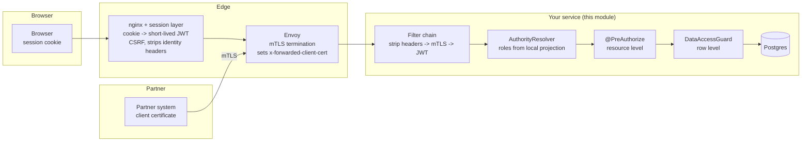

# security-spring-boot-starter

*[English](README.md) · **Русский***

Аутентификация и авторизация для сервисов Spring Boot за границей nginx/Envoy. Один принципал
(`LudwigPrincipal`) для пользователей браузера (сессионная cookie, обмениваемая на JWT на границе), партнёров по
mTLS (Envoy `x-forwarded-client-cert`) и соседних сервисов; роли определяются в каждом сервисе по локальной
проекции, а не из claim-ов токена; авторизация на уровне данных компилируется в типобезопасные предикаты QueryDSL
плюс проверку отдельного объекта; ослабление прав персональными токенами доступа; локализованные 401/403 RFC 9457;
аудит и метрики. Каждое значение по умолчанию закрыто.

| | |
|---|---|
| Роль | starter |
| Зависит от (в репозитории) | [`audit-core`](../audit-core), [`cache-spring-boot-starter`](../cache-spring-boot-starter), [`pat-core`](../pat-core), [`web-core-spring-boot-starter`](../web-core-spring-boot-starter) |
| Используется | стартерами `export`, `file-action`, `grpc-client`, `grpc-server`, `identity-projection`, `pat`, `user-settings`, модулем `test-support-security`; обоими сервисами |
| Поверхности | REST (цепочка фильтров, method security); исходящий вызов интроспекции (опциональный PAT-фильтр) |

Модель развёртывания, которую предполагает модуль:

- у пользователей браузера **непрозрачная сессионная cookie**; граница обменивает её на короткоживущий JWT на
  каждый запрос;
- партнёры вызывают REST API по **mTLS**, терминируемому Envoy;
- соседние сервисы приходят со своей **workload identity**;
- OIDC-провайдер выдаёт **только идентичность** (без ролей) и передаёт каталог пользователей по Kafka в БД каждого
  сервиса ([identity-projection](../identity-projection-spring-boot-starter));
- доступ ограничивается **по ресурсу** (может ли вызывающий вызвать эндпоинт) и **по данным** (какие строки).

### Граница или сервис

| Задача | Где | Почему |
|---|---|---|
| Терминирование TLS/mTLS, проверка клиентского сертификата | **Граница** | Там ключи и набор доверенных сертификатов партнёров |
| Cookie сессии → JWT, CSRF, отзыв сессии | **Граница** | Там хранилище сессий; сервис, не видящий cookie, не подвержен CSRF |
| Вырезание присланных клиентом заголовков идентичности | **Граница и сервис** | Один неверный маршрут иначе станет повышением привилегий |
| Грубые запреты маршрутов, rate limit, ограничения размера | **Граница** | Дёшево; отсекает злоупотребления до сервиса |
| Проверка токена (подпись, issuer, **audience**, срок) | **Сервис** | Audience - своя у каждого сервиса; сервис не должен считать, что до него доходят только через шлюз |
| Проверки ролей и прав | **Сервис** | Роли - словарь самого сервиса |
| Область данных (какие строки) | **Сервис** | Шлюз не знает, что такое строка |

Шлюз не умеет авторизацию на уровне строк, а принуждение только на шлюзе открыто для каждого пути, который его
обходит (вызовы между сервисами, Kafka-потребители, планировщики, port-forward). Шлюз - эшелон защиты, но никогда не
точка принятия решения.



### Три типа вызывающих

| | Пользователь браузера | Партнёр | Соседний сервис |
|---|---|---|---|
| Учётные данные на границе | сессионная cookie | клиентский сертификат | workload-сертификат |
| Учётные данные в сервисе | JWT, выпущенный границей | `x-forwarded-client-cert` | JWT (client credentials) или XFCC |
| Идентичность | OIDC `sub` | код партнёра | SPIFFE workload id |
| `PrincipalType` | `USER` | `PARTNER` | `SERVICE` |
| Роли из | локальной проекции потока OIDC | реестра партнёров (таблица или конфигурация) | конфигурации |
| Типичная область данных | `OWN`, `TENANT` или `ALL` | `PARTNER` | `ALL` для своей узкой задачи |

### Почему ролей нет в токене

JWT несёт `sub`, имя и, возможно, тенант. Роли даёт `AuthorityResolver`, реализованный identity-projection над
таблицей пользователей, наполняемой из Kafka:

- **отзыв ограничен TTL кэша прав (секунды), а не сроком жизни токена**;
- токены маленькие; выдача роли не требует перевыпуска;
- каждый сервис владеет своим словарём;
- токен с claim `roles` безвреден - его никто не читает.

Цена - обращение на каждый запрос; `AuthorityLookup` кэширует его в платформенном кэше `authorities`
(`purpose: security`, см. [cache](../cache-spring-boot-starter)), а identity-projection вытесняет записи при каждом
изменении пользователя.

## Использование

```xml
<dependency>
    <groupId>ru.ludwigandreas</groupId>
    <artifactId>security-spring-boot-starter</artifactId>
</dependency>
<!-- роли и выдачи из потока OIDC; без него ни у кого нет ролей -->
<dependency>
    <groupId>ru.ludwigandreas</groupId>
    <artifactId>identity-projection-spring-boot-starter</artifactId>
</dependency>
```

### Операции и роли

Код авторизует по **операции**, никогда по роли. Модуль объявляет, что он делает; какие роли могут это делать и над
какими строками, говорит только конфигурация сервиса.

```java
@Bean
OperationContributor orderOperations() {
    return () -> List.of(
            Operation.business("sales.order.read", Sensitivity.READ, "sales.op.order.read").on("order", DataAction.READ),
            Operation.business("sales.order.update", Sensitivity.CHANGE, "sales.op.order.update").on("order", DataAction.WRITE),
            Operation.business("sales.order.purge", Sensitivity.PRIVILEGED, "sales.op.order.purge"));
}

@GetMapping("/{id}")
@RequiresOperation("sales.order.read")
public OrderResponse get(@PathVariable UUID id) { ... }
```

```yaml
ludwig:
  security:
    roles:
      ORDER_AGENT:
        operations:
          sales.order.read: OWN          # только созданные им строки
          sales.order.update: OWN
      ORDER_ADMIN:
        includes: [ORDER_AGENT]
        operations:
          sales.order.read: ALL
          sales.order.update: ALL
          sales.order.purge: ALL
```

| Элемент | Что это |
|---|---|
| Идентификатор операции | `<area>.<object>.<verb>`, три сегмента в нижнем регистре. Чтение покрывает список и получение одного вида объектов; каждое отдельное изменение - своя операция |
| Чувствительность | `READ` (ничего не меняет), `CHANGE` (меняет состояние), `PRIVILEGED` (может потерять данные, меняет, кто что может, или решает, вызывается ли зависимость). Для `PRIVILEGED` нужен заголовок `Operation-Reason` (1-500 символов, иначе `400 ludwig.security.reason-required`), а персональные токены отклоняются, если не задано `ludwig.security.operations.allow-personal-access-tokens=true` |
| Поверхность | `BUSINESS` (собственный API сервиса) или `ADMIN` (только под `/admin/v1/`; см. ниже). Расхождение с путём обработчика роняет старт |
| `@RequiresOperation("<id>")` | Единственная авторизация, которую объявляет код. На методе контроллера, сервиса или gRPC; проверяется через method security, административного стража или gRPC-перехватчик - одной оценкой |
| `@RequiresAuthentication` | Метод, доступный любому аутентифицированному вызывающему |
| `ludwig.security.roles.<ROLE>` | `operations` (операция → область) и `includes` (роли, чьи операции она тоже имеет, транзитивно). Роль сопоставляется с префиксом `ROLE_` и без |
| Область | `ALL` или измерения через `+` (`OWN+TENANT`) - AND внутри выдачи, OR между ролями. `OBJECT` выдаётся субъектам (см. административную поверхность) |

Везде закрыто по умолчанию: операция, которой нет ни у одной роли, отклоняется для всех и один раз попадает в журнал;
роль с неизвестной операцией, маска, `NONE`, цикл или неопределённая роль в `includes`, измерение, которое ресурс
операции не связывает, аннотация с незаявленной операцией и ключ описания, которого нет ни в одном бандле, - каждое из
этого роняет старт. Заменённые ключи (`ludwig.admin.grants`, `ludwig.security.data.policies`,
`ludwig.security.data.default-access`, `ludwig.admin.allow-personal-access-tokens`) роняют старт, если ещё заданы. Роли -
это разрешённые роли этого сервиса (проекция идентичности для людей, `ludwig.identity.service-roles` для сервисов), а не
claim токена; пересечение с PAT по-прежнему применяется.

`GET /me/operations` перечисляет, что есть у вызывающего, - идентификатор, чувствительность, поверхность, область и
описание на его языке, - чтобы UI знал, какие элементы управления показывать; того, чего у него нет, он не
перечисляет. `GET /admin/v1/security/operations/{id}/holders` (`security.operation.read`) перечисляет роли, у которых
есть операция, с их областью и, если она унаследована, ролью-источником. Method security включается модулем всегда, что
бы ни говорил `ludwig.security.data.enabled`.

### Уровень данных

Объявите, какие колонки несут какое измерение области:

```java
@Bean
DataScopeMapping<OrderEntity> orderScopeMapping() {
    QOrderEntity order = QOrderEntity.orderEntity;
    return DataScopeMapping.forResource("order", OrderEntity.class)
            .owner(order.createdBy, OrderEntity::getCreatedBy)
            .tenant(order.tenantId, OrderEntity::getTenantId, UUID::fromString)
            .partner(order.partnerId, OrderEntity::getPartnerId)
            .build();
}
```

Операция, называющая ресурс (`.on("order", DataAction.READ)`), ограничивается им, а строки фильтруются областью каждой
роли для этой операции в `ludwig.security.roles`. Используйте там, где достигаются строки:

```java
// 1. Во время запроса - область входит в WHERE.
queryFactory.selectFrom(order)
        .where(guard.predicate("sales.order.read").and(criteria))
        .fetch();

// 2. Во время загрузки - страховка для путей, которых не видит предикат запроса.
OrderEntity entity = repository.getByIdOrThrow(id);
guard.check("sales.order.read", entity, OrderEntity::getId);
```

или аннотацией на том же отображении: `@PostAuthorize("hasPermission(returnObject, 'read')")`.

**Нужны обе половины.** Только предфильтр пропускает загрузки по id, связи и объекты, восстановленные из событий;
только постпроверка ломает пагинацию и итоги. Отображение объявляет колонку (предикат) и accessor (проверку)
вместе, поэтому они не расходятся.

**Три формы правила:**

| Правило | Привязка | Пример |
|---|---|---|
| Одна колонка - одно значение | `.owner` / `.tenant` / `.partner` / `.bind` | заказы, созданные пользователем |
| Строка связана со многими значениями, подходит любое | `.bindCollection` | заказы, где пользователь упомянут |
| Всё остальное | `.bindExpression` | упомянут или создатель, и не отозван |

```java
DataScopeMapping.forResource("order", OrderEntity.class)
        .owner(order.createdBy, OrderEntity::getCreatedBy)
        .bindCollection(ScopeDimension.of("mentioned"),
                order.mentions.any().userId,                                   // сторона запроса: коррелированный EXISTS
                e -> e.getMentions().stream().map(Mention::getUserId).toList()) // сторона загрузки
        .build();
```

`.bindExpression` - запасной выход, где ничто не проверяет согласие предиката и проверки; тестируйте их друг против
друга (пример - `ExpressionScopeBindingTest`).

**Собственные значения** даёт `DataScopeProvider`:

```java
@Bean
DataScopeProvider coverageGrants(CoverageRepository coverage) {
    return (principal, resourceType, action) -> "order".equals(resourceType) && DataAction.READ.equals(action)
            ? coverage.ordersCoveredBy(principal.subject())    // например, временная замена
            : DataScope.none();   // ничего не добавляет; области ролей продолжают действовать
}
```

Провайдер отвечает для субъекта, никогда не сравнивая роли; его спрашивают с ресурсом и действием операции (операцию,
не касающуюся строк, - с её идентификатором и `invoke`).

**Композиция**: значения внутри измерения объединяются по OR (`IN`); измерения внутри выдачи - по AND
(`OWN+TENANT`); выдачи - по OR; `ALL` сильнее всего. Области ролей и все провайдеры объединяются, поэтому провайдер
может только **расширять**; запрет - это отсутствие выдачи.
Списочный эндпоинт для вызывающего без прав возвращает **пустую страницу**, а не 403. Полная модель и примеры -
в [`docs/data-scope-configuration.md`](../../docs/data-scope-configuration.md).

### Фоновая работа

`SystemPrincipalTemplate` выполняет код планировщиков и listener-ов под явной системной идентичностью
(`ludwig.security.system-principal.*`).

### Персональные токены доступа

PAT - **ослабление** текущих прав владельца. Модуль читает claim `ludwig_pat` из assertion, полученного обменом на
границе, и сужает определённые права:

```
effective = authoritiesOf(owner, now)  ∩  token.scopes()
```

- Роль, отозванная у владельца, перестаёт работать для его токенов в пределах TTL кэша прав без отзыва токена.
  Токен может перестать работать без отзыва; запись об отказе называет токен и пропавшее право.
- Токен с scope, которого у владельца никогда не было, ничего не даёт.
- `PrincipalType` по-прежнему три значения: вызывающий по токену - тот же человек с меньшими правами.
  Предъявленные учётные данные хранятся в `LudwigAuthentication`, а не в принципале:
  `authentication.credential().isLongLived()`, `.credentialId()`, `SecurityPrincipals.currentCredential()`.
- Claim `ludwig_pat` с нечитаемым списком scope **отклоняется** (проход без ослабления дал бы все права). Claim
  неверного *типа* игнорируется (он не может прийти из обмена).
- Ограничение по audience не требует нового кода: `AudienceValidator` проверяет `aud`, выпускаемый обменом
  (`PatAudienceScopingTest`).

**Прямая аутентификация PAT** (для границы, не умеющей обмен):

```yaml
ludwig:
  security:
    pat:
      filter:
        enabled: true                               # по умолчанию выключено
        issuer-base-url: https://idp.internal
        introspection-path: /introspect
        timeout: 2s
```

Фильтр распознаёт `lpat_`, выполняет интроспекцию у выпускающего сервиса (RFC 7662) и строит аутентификацию через
то же место построения, поэтому ослабление идентично. Таблица токенов и точка отзыва остаются одни. Резолвер
bearer-токена resource server-а сообщает об отсутствии токена для значений `lpat_`, чтобы JWT-фильтр не отклонил их
раньше. Компромисс: на каждом промахе кэша интроспекции нужна доступность выпускающего сервиса (отказ - закрыт).
Удаляется выставлением `enabled: false`, когда граница научится обмену (`PatDirectAuthenticationIT` проверяет обе
конфигурации).

**Окно отзыва** - вычисляется, логируется и проверяется при старте (падение при превышении
`max-revocation-window`):

```
запрос/ответ:       время жизни assertion + время кэша границы + TTL кэша прав
долгие соединения:  интервал перепроверки + TTL кэша прав
прямой фильтр:      TTL кэша интроспекции + TTL кэша прав   (вычисляется, даже если выключен)
```

### Административная поверхность

Все административные эндпоинты платформы обслуживаются под `/admin/v1/` и авторизуются одним способом: операциями,
описанными выше, объявленными на поверхности `ADMIN` (`Operation.admin(...)`) и выданными в `ludwig.security.roles`, как
любые другие.

| Элемент | Что это |
|---|---|
| `@RequiresOperation(<Module>AdminOperations.<CONSTANT>)` | На обработчике; единственный барьер. Никогда не сочетается с `@PreAuthorize` или проверкой роли |
| `@RequiresAuthentication` | Обработчик, доступный любому допущенному вызывающему (список согласований) |
| `AdminAudit` | Записывает изменение через единственный `AuditSink`, категория `admin`, действие - идентификатор операции, из сервиса модуля внутри его транзакции |
| `AdminInvocation.require()` | Текущая операция, вызывающий и причина; `tenantScope()` для таблиц с арендатором |
| `AdminPage` / `AdminCursor` | Keyset-страницы; не более 200 строк; нераскодируемый курсор - `400` |

```yaml
ludwig:
  security:
    roles:
      NOTIFICATION_SUPPORT:
        operations:
          outbox.message.read: ALL
      NOTIFICATION_ADMIN:
        includes: [NOTIFICATION_SUPPORT]
        operations:
          outbox.message.retry: ALL
          outbox.message.discard: ALL
```

В файле `.properties` ключ с точкой записывается в скобках:
`ludwig.security.roles.NOTIFICATION_ADMIN.operations[outbox.message.discard]=ALL`.

Что отклоняет страж на `/admin/**` (`HandlerInterceptor`, поэтому он работает при любой цепочке фильтров сервиса),
по порядку:

| Вызывающий | Ответ |
|---|---|
| не аутентифицирован | `401` |
| партнёр | `403` |
| персональный токен доступа, если не задано `ludwig.security.operations.allow-personal-access-tokens=true` | `403`, `ludwig.pat.credential-not-permitted` - тот же тип, что у поверхности PAT |
| человек (`USER`), действующий не через одну из сторон `ludwig.admin.human-callers.required-via`, если список задан | `403`, публикуется как отказ авторизации и аудируется |
| операция, которой у него нет | `403`, публикуется как отказ авторизации и аудируется |
| операция `PRIVILEGED` без `Operation-Reason` (1-500 символов) | `400`, `ludwig.security.reason-required` - только после проверки выдачи |
| `@AdminObject` вне его области, если область вызывающего ограничивает объекты | `403`, а для операции `READ` - собственный `404` области «не найдено»; аудируется |
| обработчик под `/admin/` без обеих аннотаций или с операцией `BUSINESS` | `403`, а второе роняет старт |

Запись `public-paths`, совпадающая с `/admin/v1/`, роняет старт. Поверхность существует только при наличии конвейера
ошибок web-core. `ludwig.admin.enabled=false` убирает стража, и оставшийся административный обработчик тогда отклоняется
(`403`) через method security, а не обслуживается.

Действующая сторона: claim делегирования в токене (`ludwig.security.jwt.actor-claim`, по умолчанию `act`, читается
как `act.sub` по RFC 8693, вложенные `act` сохраняются цепочкой не длиннее 5) называет сторону, через которую пришёл
запрос, например `admin-console`. Это только идентичность, никогда не источник ролей; она записывается в аудит как
`via` действующего лица. Присутствующий, но нечитаемый claim (не объект, нет `sub`, слишком глубокая вложенность)
отклоняет токен с `401`; пустой `actor-claim` выключает его чтение. При
`ludwig.admin.human-callers.required-via: [admin-console]` человек попадает в `/admin/**` только через эту сторону, а
сервисные принципалы не затрагиваются: держите break-glass сервисный принципал на случай недоступности UI. Учитывается
только claim проверенного токена, никогда не заголовок.

Ограничение по объектам: обработчик помечает переменную пути, называющую его объект, аннотацией `@AdminObject` (её
`notFound` - собственный код «не найдено» области, поэтому чтение вне области отвечает так же, как для отсутствующего
объекта), а список фильтруется через `OperationAuthority.admitted`. Роль ограничивает операцию объектами, выдавая ей
`OBJECT`, а сами объекты выдаются субъектам по измерению `object` с ключом - идентификатором операции и действием
`invoke` (через выдачи проекции идентичности); роль с `ALL` допускает любой объект. См.
[настройку областей данных](../../docs/data-scope-configuration.ru.md#административные-объекты).

Согласование «четырёх глаз»: `ludwig.admin.approval.required` перечисляет операции `ADMIN` `PRIVILEGED`, вызовы которых
должен одобрить второй обладатель (по умолчанию пусто; незаявленный идентификатор или любая другая операция, как и список без
`AdminApprovalStore`, роняют старт - JDBC-хранилище даёт job-core). Такой вызов после проверки выдачи и причины не
выполняется: запрос (метод, путь, query, тело до 64 КиБ - больше `413` - и `Operation-Reason`) записывается, а ответ -
`202` с согласованием, чей конверт операции `PENDING`, и `Location: /admin/v1/approvals/{id}`. `/admin/v1/approvals`
доступен любому вызывающему, которого пускает поверхность; что он видит и решает, ограничено его операциями:

| Эндпоинт | Что делает |
|---|---|
| `GET /admin/v1/approvals?status=` | Согласования операций, которыми владеет вызывающий, новые первыми; тел запросов нет никогда |
| `GET /admin/v1/approvals/{id}` | Одно согласование; тело - только обладателю, не являющемуся автором, пока оно ожидает |
| `POST .../{id}/approve` | Обладатель, не являющийся автором, одобряет: права автора перепроверяются (`409`, если утрачены), затем сохранённый запрос выполняется тем же обработчиком от имени одобряющего, его статус и тело (16 КиБ) записываются - конверт `SUCCEEDED` при 2xx, иначе `FAILED` |
| `POST .../{id}/reject` | Обладатель, не являющийся автором, отклоняет (`CANCELLED`) |
| `POST .../{id}/withdraw` | Автор отзывает (`CANCELLED`) |

Одобрение собственного запроса - `403`; решённое, отозванное или истёкшее согласование - `409`. Без решения дольше
`ludwig.admin.approval.ttl` (`PT24H`) оно истекает (`EXPIRED`); оставленное выполняться остановившейся репликой через
пять минут помечается прерванным и не выполняется повторно. Запрос, решение, отзыв и истечение аудируются, а
собственное событие выполненной операции содержит `requestedBy` и `approvedBy`. Ограничения по арендатору и по
объектам при выполнении применяются к одобряющему.

Ограничение по арендатору: `USER` видит ресурсы только ровно своего арендатора (пользователь без арендатора - только
ресурсы без арендатора); `SERVICE` не ограничен. Модули применяют `tenantScope()` к таблицам с арендатором.

Какие элементы управления показывать, административный UI узнаёт из `GET /me/operations` с фильтром `surface=ADMIN`.

## Конфигурация

```yaml
spring:
  security:
    oauth2:
      resourceserver:
        jwt:
          # issuer-uri выполняет OIDC discovery при старте: сервис не стартует, пока провайдер недоступен.
          # Используйте jwk-set-uri (загружается лениво), если это важно.
          issuer-uri: https://login.example.internal/realms/corp

ludwig:
  security:
    enabled: true
    problem-type-prefix: "urn:ludwig:security:"
    public-paths: [/actuator/health, /actuator/health/**, /actuator/info]   # заменяет список по умолчанию
    strip-identity-headers: true
    jwt:
      enabled: true
      subject-claim: sub
      name-claim: name
      tenant-claim: tenant_id
      service-client-claim: client_id   # наличие помечает токен соседнего сервиса
      actor-claim: act                  # делегирование по RFC 8693, пишется в аудит как via; пусто - выключено
      audiences: [my-service]
      require-audience: true
    mtls:
      enabled: false
      trusted-proxies: []               # обязательно при включении; 0.0.0.0/0 запрещено
      trust-native-forward-headers: false
      service-identity-prefix: spiffe://mesh/ns/
      partners:                         # или таблица security_partner в identity-projection
        acme:
          display-name: ACME GmbH
          spiffe-id: spiffe://partners/acme
          certificate-hash: 468ed3...   # опциональное закрепление; обновлять при каждом перевыпуске
    authorities:
      require-resolver: false           # true в каждом развёрнутом окружении
    data:
      enabled: true                     # ограничение строк; method security остаётся включённым в любом случае
      unscoped-resources: []            # справочные данные, намеренно без ограничений
    roles: {}                           # <ROLE>: { includes: [...], operations: { <operation>: <scope> } }
    operations:
      allow-personal-access-tokens: false   # операции PRIVILEGED и /admin/** отклоняют PAT
    pat:
      assertion-lifetime: 5m            # как у выпускающего
      edge-cache-lifetime: 5m           # как у границы
      revalidation-interval: 1m
      max-revocation-window: 15m
      validate-revocation-window: true
      filter: { enabled: false, issuer-base-url: , introspection-path: /introspect, timeout: 2s }
    audit:
      enabled: true
      log-grants: false
    metrics:
      enabled: true
    system-principal:
      subject: system
      roles: []
```

Кэш прав настраивается в `ludwig.cache.caches.authorities.*` (TTL = сколько ещё работает отозванная роль;
`purpose: security` обеспечивает потолок). Кэш интроспекции - `ludwig.cache.caches.pat-introspection.*`.

## Развёртывание

### Граница (Envoy) для партнёров по mTLS

```yaml
forward_client_cert_details: SANITIZE_SET   # заменить любой входящий XFCC; никогда не дописывать к клиентскому
set_current_client_cert_details:
  uri: true        # SPIFFE id - переживает перевыпуск
  dns: true
  subject: true
  cert: false      # PEM добавил бы килобайты в каждую строку лога
```

`APPEND_FORWARD` позволил бы клиенту подставить свой элемент. Эталонные конфигурации:
[`docs/envoy-partner-gateway.yaml`](docs/envoy-partner-gateway.yaml), [`docs/nginx-edge.conf`](docs/nginx-edge.conf).

**`trusted-proxies` несёт нагрузку**: `x-forwarded-client-cert` - обычный заголовок, которому можно верить только
потому, что до порта может дойти только прокси. Задайте подсеть sidecar/ingress и ничего шире; `0.0.0.0/0`
запрещено. Заголовок от любого другого узла **отклоняется** (а не игнорируется) и учитывается.

**`server.forward-headers-strategy`**: `framework` безопасен (модуль разворачивает адрес до того, что видел
контейнер); `native` (Tomcat `RemoteIpValve`) доверяет `X-Forwarded-For` от любого узла частной сети и позволяет
любой нагрузке выдать себя за sidecar - при включённом mTLS **старт падает**. Если `native` нужен, сузьте
`server.tomcat.remoteip.internal-proxies` и выставьте `ludwig.security.mtls.trust-native-forward-headers=true`.

Партнёры сопоставляются по SPIFFE URI, затем DNS SAN, затем точному subject DN, с опциональным закреплением
отпечатка. Сопоставляйте по идентификатору, переживающему перевыпуск сертификата.

### CSRF и отсутствие состояния

Цепочка фильтров без состояния, CSRF выключен: сессионная cookie не доходит до сервиса. **Если сервис когда-либо
станет принимать сессионную cookie напрямую, включите CSRF в том же изменении.**

### Порядок внедрения в существующий сервис

1. Объявите операции каждого модуля и переведите всю авторизацию на `@RequiresOperation`; режима «разрешить всё» на
   время миграции нет - так задумано.
2. Пишите `ludwig.security.roles` по одной роли, сначала выдавая `ALL`; журнал старта перечисляет операции, которых
   нет ни у одной роли, а `/admin/v1/security/operations/{id}/holders` показывает, у кого что есть.
3. Напишите бины `DataScopeMapping` и сужайте области (`OWN`, `TENANT`), начиная с самых чувствительных данных.
4. Включите `authorities.require-resolver` и `jwt.require-audience` во всех развёрнутых окружениях.
5. Включите mTLS на партнёрских маршрутах последним, когда `trusted-proxies` верен в каждом окружении.

## Наблюдаемость

**Метрики:**

| Метрика | Тип | Теги | Смысл |
|---|---|---|---|
| `ludwig.security.authentication` | counter | `principal.type`, `outcome`, `reason` | Результаты аутентификации; `reason=untrusted-proxy` - кто-то обходит mesh |
| `ludwig.security.access.denied` | counter | `resource`, `action` | Отказы (на уровне ролей и строк) |
| `ludwig.security.authorities.cache` | counter | `principal.type`, `result` | Попадания/промахи кэша прав |
| `ludwig.security.data.scope` | counter | `resource`, `access` | Фактическая ширина области; `access=ALL` на ограниченном ресурсе - область роли шире задуманного |

Теги - только из ограниченного словаря; ничего, чем управляет вызывающий.

**Логи** (`WARN`, если не указано иное): XFCC от недоверенного узла (отклонён), сертификат совпал по
идентификатору, но отличается отпечаток, нет партнёра для сертификата, недоступна интроспекция PAT, непригодное
значение области данных, `hasPermission` без отображения (отказ), запись `public-paths`, разрешающая широкий
шаблон, `validate-revocation-window=false`, не удался аудит отказа. `INFO`: включена проверка audience, значения
окна отзыва PAT. `WARN`: операции, которых нет ни у одной роли.

**Рекомендуемые алерты:**

| Условие | Почему |
|---|---|
| `increase(ludwig_security_authentication_total{reason="untrusted-proxy"}[5m]) > 0` | Прямой доступ в обход mesh или подделка |
| Всплеск `ludwig_security_access_denied_total` по одному ресурсу | Зондирование или сломанный клиент/сопоставление ролей |
| `ludwig_security_data_scope_total{access="ALL"}` для ресурса, который должен быть ограничен | Политика не срабатывает |
| Лог `Could not introspect a personal access token` | Выпускающий сервис недоступен: PAT отказывают |

## Аудит

Решения идут через платформенный `AuditSink`:

| Поле | Значение |
|---|---|
| category | `access` |
| action | `access.denied` (на уровне ролей - `AuthorizationDeniedAuditListener`, на уровне строк - `DataAccessGuard`); `access.granted` - только при `audit.log-grants: true` |
| outcome | `DENIED` для отказов (не `FAILURE`) |
| attributes | тип и id ресурса, действие, причина, `scopeAccess`, id PAT и пропавшее право для отказов по токену |

Без payload и токенов. `PrincipalActorResolver` (регистрируется независимо от `ludwig.security.enabled` и
`audit.enabled`) учит платформенное определение действующего лица понимать `LudwigPrincipal`, поэтому каждый
`AuditEvent.actor` и `created_by` несут subject.

**Известный пробел:** ошибки аутентификации (нет, неверный или истёкший токен, отвергнутый сертификат)
учитываются в `ludwig.security.authentication`, но не записываются в аудиторский след.

## Runbook

| Симптом | Вероятная причина | Что делать |
|---|---|---|
| Сервис не стартует: OIDC discovery | Провайдер из `issuer-uri` недоступен | Восстановить связность или использовать `jwk-set-uri` |
| Старт падает на `ludwig.security.roles` | Неизвестная операция, ресурс без отображения, измерение, которое ресурс не связывает, `NONE`, маска, цикл в `includes`, ещё заданный заменённый ключ | Исправить, как указано в сообщении |
| Старт падает: `trusted-proxies` / `forward-headers-strategy=native` | Небезопасные настройки mTLS | Сузить прокси; см. «Развёртывание» |
| Старт падает: нет audience / нет резолвера | `require-audience` / `require-resolver` без настройки | Задать `jwt.audiences`; добавить identity-projection |
| Все пользователи получают 403 | Нет данных `AuthorityResolver` (проекция пуста) или операции нет ни у одной роли | Проверить потребление identity-projection; проверить обладателей операции |
| У пользователя всё ещё работает отозванная роль | TTL кэша прав | Подождать ≤ TTL (`ludwig.cache.caches.authorities.ttl`) |
| Партнёр получает 401 после перевыпуска сертификата | Сопоставление по нестабильному идентификатору или закреплённый отпечаток | Сопоставлять по SPIFFE URI/SAN; обновить `certificate-hash` |
| `reason=untrusted-proxy` | Запрос дошёл до пода мимо прокси mesh | Найти путь (port-forward, лишний ingress); исправить сетевую политику |
| 500 вместо 403 внутри контроллеров | Ни web-core, ни собственный advice не обрабатывают `AccessDeniedException` | Добавить web-core (рекомендуется) |
| «Почему пользователь X не может сделать Y?» | - | `SELECT occurred_at, action, resource_type, resource_id, reason, attributes FROM audit_event WHERE category = 'access' AND actor_subject = '<x>' ORDER BY occurred_at DESC LIMIT 50;` |
| PAT не работают в сервисе с прямым фильтром | Выпускающий сервис недоступен, неверный `issuer-base-url` | Смотреть предупреждение `Could not introspect` и связность |

## Тестирование

Модульные тесты разбора XFCC, доверенных прокси, mTLS-фильтра, проверки audience, кэширования прав, композиции
областей и построения предикатов (включая привязки к коллекциям и выражениям), data guard и permission evaluator,
аудита method security, отображения проблем, ослабления прав PAT, PAT-aware bearer-резолвера, клиента и кэша
интроспекции, проверки окна отзыва, автоконфигурации. В сервисе используйте
[`test-support-security`](../test-support-security) для построения принципалов в MockMvc.

## Проектные решения

| Ситуация | Поведение | Почему не наоборот |
|---|---|---|
| Операции нет ни у одной роли | Отказ и запись в журнале при старте | Новый эндпоинт вышел бы незащищённым |
| Политика называет ресурс без отображения | Падение старта | Он считался бы неограниченным |
| Политика называет непривязанное измерение | Падение старта | Неисполнимое условие нельзя тихо игнорировать |
| Опечатка в выдаче (`OWNN`) | Падение старта | Иначе 500 на первом запросе с этой ролью |
| Ресурс и unscoped, и с политикой | Падение старта | Одно молча победит |
| У принципала нет значения обязательного измерения | Отказ | Отбрасывание условия превращает «мой тенант» во «все тенанты» |
| Значение выдачи не разбирается в тип колонки | Отказ | Это пустое множество, а не отсутствующий фильтр |
| Хранилище ролей недоступно | Запрос падает (500) | «Нет ролей» при сбое - это авария, а для правил-запретов - тихая выдача |
| XFCC от недоверенного узла | Отклоняется и учитывается | Игнорирование скрывает подделку |

- **Нет работы с сессиями, страниц входа и выпуска токенов** - это задача границы.
- **Нет Hibernate `@Filter` и RLS PostgreSQL**: предикаты QueryDSL над сгенерированными Q-типами ломают сборку при
  переименовании колонки. Добавьте RLS *под* этим для защиты от скомпрометированного сервиса.
- **По умолчанию нет распределённого кэша прав**: права дёшево вычислить заново, а общий кэш - цель отравления;
  вытеснение идёт по Kafka-топику, который читает каждый экземпляр.
- **Неинформативные тела 401/403**; подробности - в аудиторском следе. Сообщения переопределяются тем же ключом в
  бандле сервиса.
- **Пока нет принуждения для потоковых транспортов**: `revalidation-interval` есть; первый долгоживущий транспорт
  должен добавить обеспечивающий тест.
